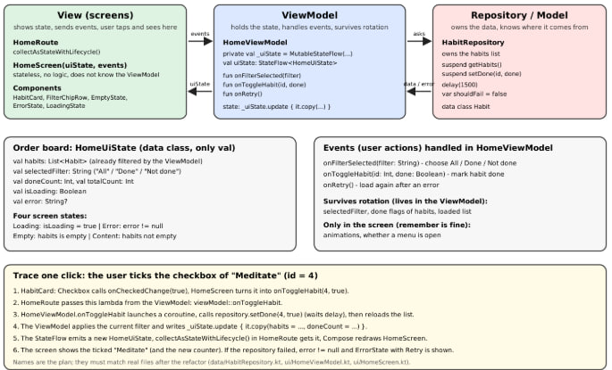
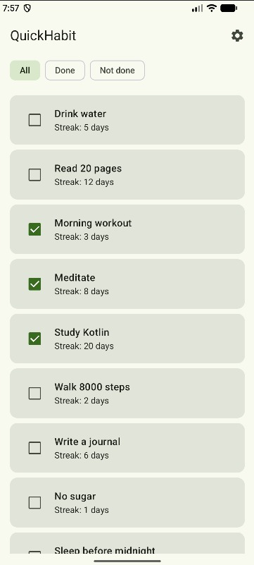
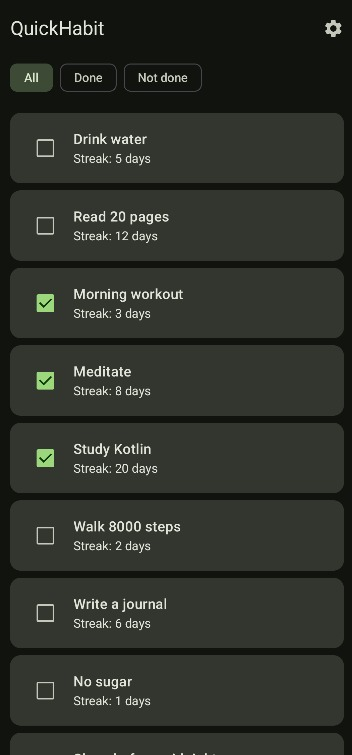
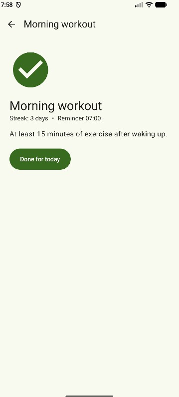
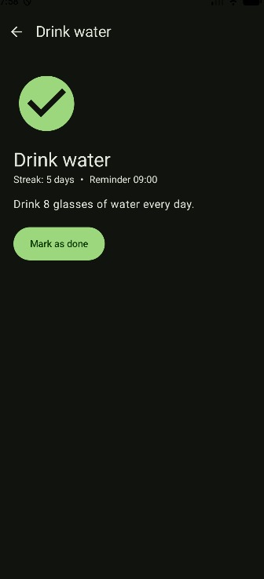
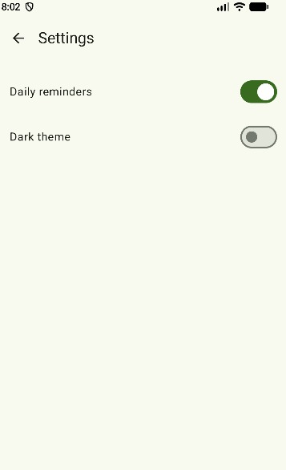
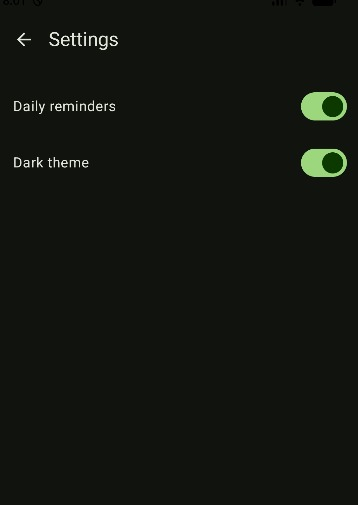
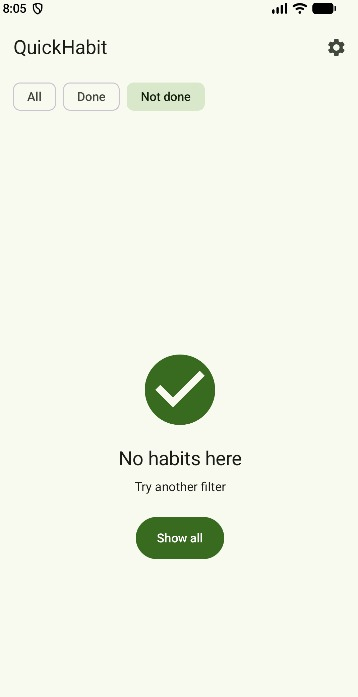
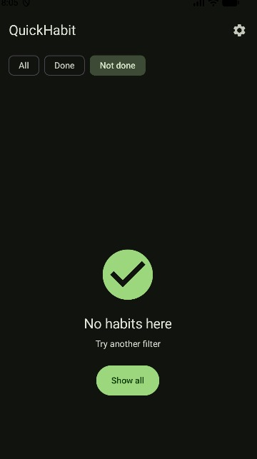

# QuickHabit

A minimalist Android habit tracker built with Kotlin and Jetpack Compose. The app shows a list of daily habits, lets you filter them, mark them as done, open a detail screen with the streak, and switch between light and dark theme.

This repository contains the **SIS3** app (Jetpack Compose: layout and styling), refactored in **SIS4** to MVVM (ViewModel, StateFlow, unidirectional data flow). See [Architecture (SIS4)](#architecture-sis4).

## What is implemented

- **Home screen**: `Scaffold` + `TopAppBar` with a settings icon, a `LazyRow` of filter chips (All / Done / Not done) and a `LazyColumn` with 10 habit cards. Each card has a checkbox to mark the habit as done.
- **Habit Detail screen**: opened by tapping a card. The habit `id` is passed as a navigation argument and the habit is found in the list by that id. Shows an image, the name, the streak, the reminder time, the description and a "Mark as done" button. Back button in the `TopAppBar`.
- **Settings screen**: two switches (Daily reminders, Dark theme). The Dark theme switch changes the theme of the whole app.
- **Empty state**: shown when the selected filter has no habits (image, text and a button that resets the filter).
- **Custom theme**: green color scheme in `Color.kt` / `Theme.kt`, light and dark. Screens use only `MaterialTheme.colorScheme` and `MaterialTheme.typography`, there are no hardcoded colors or font sizes in screens.
- **Layout details**: long habit names are cut with an ellipsis (`maxLines = 1`, `overflow = Ellipsis`), the image has a `contentDescription`, buttons and clickable icons are at least 48 dp, spacing uses only 8, 16 and 24 dp.
- **Navigation Compose** connects the three screens (`home`, `detail/{habitId}`, `settings`).
- **State**: the habit list and its "done" flags are kept in one place (`QuickHabitApp`) and shared by Home and Detail; the selected filter uses `rememberSaveable` + `mutableStateOf`.

### Not implemented in this version

These ideas from the first project description (SIS1) are not part of SIS3 and are not in the app yet: creating, editing and deleting habits, saving data on the device (the data is a hardcoded list, "done" flags and the theme choice reset when the app is closed), real reminder notifications (the Daily reminders switch only changes its own state), and streak history.

## Sketch vs app

The sketches are in the [`design/`](design/) folder. They were committed before any screen code (the very first commit only contains the empty Android Studio project template).

| Screen | Sketch | Final app |
|---|---|---|
| Home | `Scaffold`, `TopAppBar` with settings `IconButton`, `LazyRow` of chips, `LazyColumn` of `Card` > `Row` with checkbox and two `Text` | Same structure. Chips are `FilterChip` (All / Done / Not done). |
| Detail | `TopAppBar` with back button, `Image` with content description, name, `Row` with streak, description/history `Text`, "Mark as done" `Button` | Same structure. The `Row` also shows the reminder time, the content description is an accessibility attribute of the `Image` (not visible text), and the description is plain text without a history list. |
| Settings | `TopAppBar` with back button, two `Row`s with `Text` and `Switch` | Same. The Dark theme switch really changes the theme. |
| Empty state | Separate screen with `TopAppBar`, centered `Column` with `Image`, two `Text` and a button ("No habits yet" / "Add your first one" / "Add") | Shown inside the Home screen under the chips when the filter has no habits ("No habits here" / "Try another filter" / "Show all"). The sketch version is kept as a `@Preview`. |

## Architecture (SIS4)

The app uses MVVM with unidirectional data flow: **events go up** to the ViewModel, **state comes down** to the screen.



| Layer | Files | Responsibility |
|---|---|---|
| View (screens) | `MainActivity.kt`: `HomeRoute`, `HomeScreen`, `HabitCard`, `FilterChipRow`, `EmptyState`, `ErrorState`, `LoadingState` | Shows `HomeUiState` and passes user actions up. No business logic. |
| ViewModel | `ui/home/HomeViewModel.kt` | Holds the state in `MutableStateFlow`, handles events, survives rotation. |
| State | `ui/home/HomeUiState.kt` | `data class` with `val` properties only. |
| Model / Repository | `data/HabitRepository.kt`, `data/Habit.kt` | Owns the habit list, waits with `delay(1500)`, can fail with `shouldFail = true`. |

### UiState (`HomeUiState`)

| Field | Meaning |
|---|---|
| `habits` | the list shown on screen (already filtered by the ViewModel) |
| `allHabits` | the full list, used by the Detail screen to find a habit by id |
| `selectedFilter` | `"All"`, `"Done"` or `"Not done"` |
| `doneCount`, `totalCount` | numbers for the filter chips |
| `isLoading` | true while the repository is loading |
| `error` | error message or `null` |

Four screen states: **loading** (`isLoading`), **error** (`error != null`), **empty** (`habits` is empty), **content**. Each one has a `@Preview` in `MainActivity.kt` (`HomeLoadingPreview`, `HomeContentPreview`, `HomeEmptyPreview`, `HomeErrorPreview`).

### Events handled in `HomeViewModel`

- `onFilterSelected(filter)`: changes `selectedFilter` and recalculates `habits`.
- `onToggleHabit(id, done)`: marks a habit as done or not done.
- `onRetry()`: loads the data again after an error.

### Trace one click: ticking the checkbox of "Meditate" (id = 4)

1. `HabitCard` (`MainActivity.kt`): the `Checkbox` calls `onCheckedChange(true)`, and `HomeScreen` turns it into `onToggle(habit.id, isChecked)`, which is `onToggle(4, true)`.
2. `HomeRoute` passed `viewModel::onToggleHabit` as the `onToggle` lambda, so the call arrives in `HomeViewModel.onToggleHabit(4, true)`.
3. `onToggleHabit` updates its list of habits (`allHabits.map { ... copy(doneToday = done) }`) and calls `refresh()`. Then it starts a coroutine in `viewModelScope` that calls `HabitRepository.setDone(4, true)`.
4. `refresh()` calls `_uiState.update { it.copy(habits = applyFilter(...), allHabits = ..., doneCount = ..., totalCount = ..., isLoading = false, error = null) }`.
5. The public `uiState: StateFlow<HomeUiState>` emits a new value. `HomeRoute` collects it with `collectAsStateWithLifecycle()`, and Compose recomposes `HomeScreen`.
6. The screen shows "Meditate" as ticked (line-through, colored card) and the new `Done (n)` counter on the chip. `HomeScreen` itself did not change any data.

Loading and error follow the same path: `loadHabits()` sets `isLoading = true`, and if `HabitRepository.getHabits()` throws, `error` is set and `ErrorState` shows a Retry button that calls `onRetry`.

### What survives rotation

Everything that is in `HomeViewModel` / `HomeUiState`: the selected filter, the done flags and the loaded list. The Dark theme switch uses `rememberSaveable`. Only the look of the UI (animations) stays in `remember`.

### Proof: rotation and lifecycle logs

Logcat filter: `tag~:HomeViewModel|MainActivity`

[log cat](screenshots/l_home.jpeg)

**Explanation:** TODO: write 3-4 sentences in your own words: why `MainActivity` went through `onPause` / `onStop` / `onDestroy` / `onCreate` again after rotation, but `HomeViewModel` shows no `onCleared` and no second `init`.

## Screenshots
| Screen | Light | Dark |
|---|---|---|
| Home |  |  |
| Habit Detail |  |  |
| Settings |  |  |
| Empty state |  |  |
## Project structure

```text
app/src/main/java/com/example/quickhabit/
├── MainActivity.kt        # lifecycle logs, navigation, HomeRoute, stateless screens, components, previews
├── data/
│   ├── Habit.kt           # data class Habit, the habits list, filters
│   └── HabitRepository.kt # owns the data, delay(), simulated error
├── ui/home/
│   ├── HomeUiState.kt     # UI state (data class, val only)
│   └── HomeViewModel.kt   # StateFlow, events, filtering, counters
└── ui/theme/
    ├── Color.kt           # all color values (light and dark)
    ├── Theme.kt           # QuickHabitTheme and color schemes
    └── Type.kt            # typography
app/src/main/res/drawable/
└── ic_empty_habits.xml    # vector image used on Empty state and Detail
design/                    # labeled screen sketches
screenshots/               # screenshots used in this README
AI_USAGE.md                # how AI was used in this project
```

Reusable composables (all in `MainActivity.kt`, each with a `@Preview`, dark previews included): `HabitCard`, `FilterChipRow`, `EmptyState`, `SettingRow`.

## Build and run

1. Clone the repository: `git clone https://github.com/KabylanbekBagdaulet/QuickHabit.git`
2. Open the project folder in Android Studio.
3. Let Gradle sync automatically.
4. Connect a device or start an emulator (API 24 or higher; API 35/36 is recommended).
5. Click Run.

## AI usage

See [AI_USAGE.md](AI_USAGE.md).
